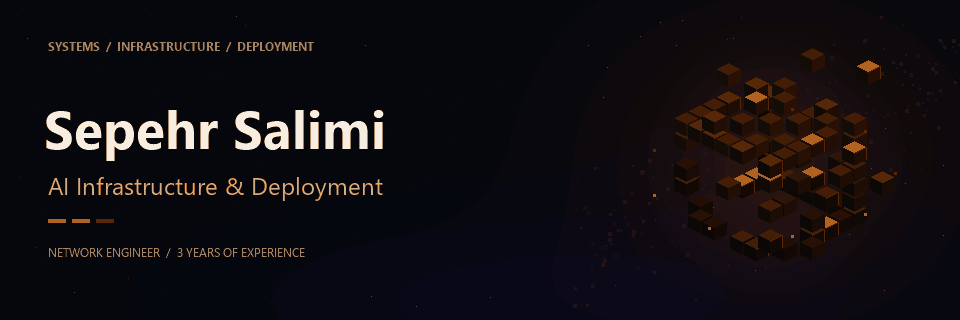

  

  <strong>AI INFRASTRUCTURE &amp; DEPLOYMENT</strong>

# Sepehr Salimi

## AI Infrastructure & Deployment

Currently deploying **AI infrastructure and internal AI services** at [Dalgostar Bistoon](https://dalgostar.com), building on **3 years of experience in network engineering**.

## Infrastructure foundation

| Area | Expertise |
| :--- | :--- |
| **Networking** | Cisco |
| **Virtualization** | VMware vSphere |
| **Linux systems** | Linux |
| **Microsoft systems administration** | Windows Server 2025 · MCSA / MCSE skillset |

## Programming

**Python · Java**

---

Networks. Systems. Infrastructure.

